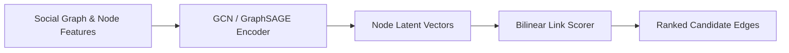

# Social Network Link Prediction: Graph Neural Networks (GCN & GraphSAGE)


A graph representation learning system for link prediction and friend recommendation on complex scale-free networks.

## Architecture


## Quick Verification
```bash
python -c "from src.eda.graph_stats import analyze_graph_topology; analyze_graph_topology()"
```
